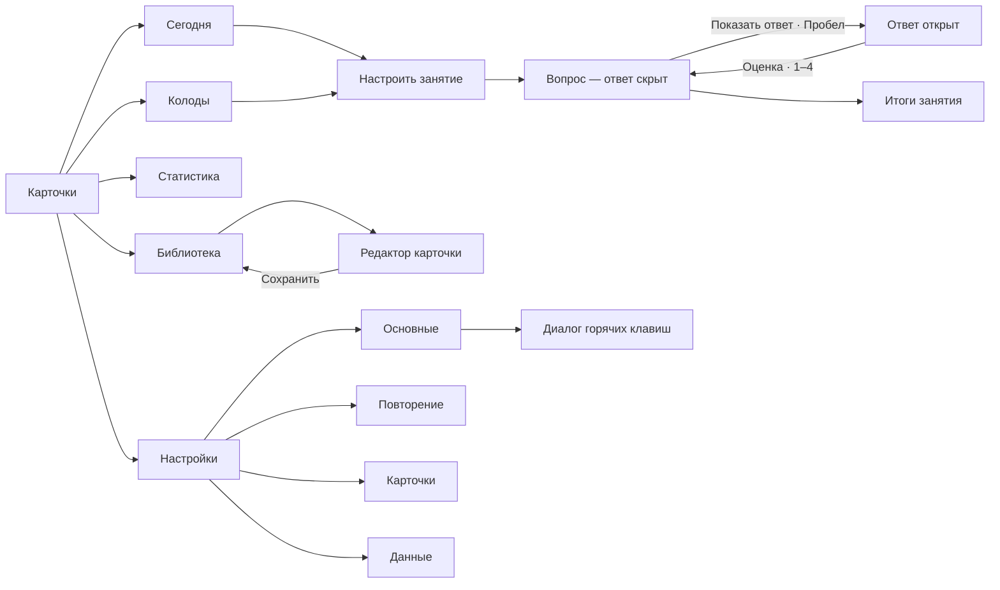

# Карта действий и состояний

[Каталог](index.html) · [Все состояния](STATES.md) · [Визуальная система](DESIGN.md)

Это проектируемое поведение, сопоставленное с визуальными референсами. Ссылки указывают на лист, а ID — на панель внутри него. При расхождении текста в PNG действуют следующие правила.

## Согласованные правила

- До раскрытия ответа основное учебное действие — **«Показать ответ»** (Пробел); доступны также пропуск и аудио. Четыре оценки скрыты. В типе «Ввод ответа» результат проверки также раскрывается действием «Показать ответ» / Пробел; подпись «Проверить» на листе 08 — иллюстративный вариант растра, для реализации использовать единое действие раскрытия.
- После раскрытия появляются ровно четыре оценки: **Снова / Трудно / Хорошо / Легко**, клавиши **1 / 2 / 3 / 4**. Оценка обновляет расписание и открывает следующий вопрос со скрытым ответом. Интервалы в макетах — примеры, алгоритм планирования не специфицирован.
- Настройки имеют четыре главные вкладки: **Основные / Повторение / Карточки / Данные**. «Горячие клавиши» — диалог внутри «Основные». Общие настройки сохраняются автоматически после допустимого изменения; невалидное значение не фиксируется. Редактор карточки сохраняется явной кнопкой **«Сохранить»** или «Добавить карточку».
- **Отмена / Escape** в диалоге закрывают его без фиксации черновых изменений и возвращают фокус вызвавшему элементу. Применение в диалогах выполняется явной кнопкой. Escape не откатывает ранее сохранённую карточку или уже автоматически сохранённую настройку. При уходе из изменённого редактора показывается выбор «Сохранить / Не сохранять / Отмена»; последний вариант оставляет редактор открытым.
- Удаление, сброс прогресса, восстановление копии и другие опасные операции требуют явного подтверждения с названием объекта и последствиями. Отмена подтверждения ничего не меняет. Для удаления карточки предусмотрена отмена в течение 5 секунд; её наличие не заменяет подтверждение. Для удаления всех учебных данных кнопка недоступна до точного ввода названия коллекции; сначала предлагается резервная копия.
- Встроенные ссылки этого каталога только показывают изображения. Они не изменяют данные и не выполняют действия приложения.

## Основная навигация

Переход между основными разделами выполняется в боковой панели. Занятие, редактор, импорт и диалоги — вложенные сценарии. Расширенные функции размещаются внутри существующих разделов, без новых обязательных пунктов боковой панели.

## Запуск и главный экран

| Действие | Референсы | Результат и возврат |
|---|---|---|
| Первый запуск → создать колоду или импортировать | [01.1 · Добро пожаловать](sheets/sheet-01.png); [01.2 · Пока нет колод](sheets/sheet-01.png); [01.3 · Первая колода](sheets/sheet-01.png); [01.4 · Всё готово](sheets/sheet-01.png) | После создания доступны три демонстрационные карточки и начало занятия; импорт ведёт в мастер. |
| Сегодня → открыть поиск / изменить запрос / очистить запрос | [base-01 · Сегодня](screens/base-01.png); [02.1 · Глобальный поиск](sheets/sheet-02.png); [02.2 · Ничего не найдено](sheets/sheet-02.png) | Выбор результата открывает карточку или колоду; отсутствие совпадений не удаляет данные. |
| Сегодня → колокольчик / другое слово дня / озвучить | [02.3 · Уведомления](sheets/sheet-02.png); [02.4 · Другое слово дня](sheets/sheet-02.png) | Отметить уведомления прочитанными; заменить слово или воспроизвести его аудио. |
| Перейти в раздел через боковую панель или клавиатуру | [20.4 · Сайдбар и клавиатура](sheets/sheet-20.png); [base-02 · Колоды](screens/base-02.png); [base-03 · Статистика](screens/base-03.png); [base-04 · Библиотека](screens/base-04.png); [base-05 · Настройки](screens/base-05.png) | Выделить текущий раздел; перед уходом из изменённого редактора проверить несохранённые правки. |

## Колоды

| Действие | Референсы | Результат и возврат |
|---|---|---|
| Колоды → раскрыть вложенность / сетка / избранные / фильтр | [03.1 · Вложенные колоды](sheets/sheet-03.png); [03.2 · Сетка](sheets/sheet-03.png); [03.3 · Избранные](sheets/sheet-03.png); [03.4 · Нет подходящих колод](sheets/sheet-03.png) | При пустом результате предложить сброс фильтров; раскрытие не меняет иерархию. |
| Новая колода / изменить название, описание, иконку | [04.1 · Новая колода](sheets/sheet-04.png); [04.2 · Редактировать колоду](sheets/sheet-04.png) | Проверка названия перед «Создать» или «Сохранить»; Отмена закрывает черновик. |
| Меню колоды → создать подколоду / переместить | [05.1 · Меню колоды](sheets/sheet-05.png); [04.1 · Новая колода](sheets/sheet-04.png); [04.3 · Переместить колоду](sheets/sheet-04.png) | Выбрать родителя; запретить перемещение внутрь самой себя или потомка. |
| Меню колоды → свойства / избранное | [05.3 · Свойства колоды](sheets/sheet-05.png); [21.4 · Избранная колода](sheets/sheet-21.png) | Свойства открывают сведения; избранное меняет признак с обратной связью. |
| Удалить колоду → подтвердить / отменить | [04.4 · Удалить колоду?](sheets/sheet-04.png) | Явно назвать колоду и предупредить о входящих карточках. |
| Начать повторение → настроить количество и область | [05.2 · Настроить занятие](sheets/sheet-05.png); [base-06 · Повторение — вопрос](screens/base-06.png) | После «Начать» открыть вопрос со скрытым ответом. |

## Занятие

| Действие | Референсы | Результат и возврат |
|---|---|---|
| Вопрос → показать ответ → выбрать оценку | [base-06 · Повторение — вопрос](screens/base-06.png); [06.1 · Ответ открыт](sheets/sheet-06.png); [06.2 · Снова](sheets/sheet-06.png); [06.3 · Трудно / Хорошо](sheets/sheet-06.png); [06.4 · Легко](sheets/sheet-06.png) | Пробел раскрывает ответ; 1–4 оценивают только раскрытый ответ. Следующий вопрос снова скрыт. |
| Выбрать обратную карточку / пропуск / ввод ответа | [08.1 · Обратная карточка](sheets/sheet-08.png); [08.2 · Пропуск в предложении](sheets/sheet-08.png); [08.3 · Введите ответ](sheets/sheet-08.png); [08.4 · Проверка ввода](sheets/sheet-08.png) | Обратная и пропуск раскрываются кнопкой; ввод проверяется с показом собственного и правильного ответа. |
| Приостановить → продолжить / завершить раньше | [07.1 · Пауза](sheets/sheet-07.png); [07.2 · Завершить раньше?](sheets/sheet-07.png) | Продолжить возвращает текущее состояние; досрочный выход требует подтверждения. |
| Пропустить карточку → следующий скрытый вопрос / отменить пропуск | [07.3 · Пропустить](sheets/sheet-07.png) | Пропуск не является оценкой; доступна обратная связь с отменой. |
| Закончить очередь / открыть Сегодня без заданий | [07.4 · Занятие завершено](sheets/sheet-07.png); [18.2 · Всё повторено](sheets/sheet-18.png) | Показать итоги и возврат на главный экран; не выдавать демонстрационные числа за реальные. |
| Аудио не воспроизводится → повторить / заменить файл | [18.3 · Не удалось воспроизвести](sheets/sheet-18.png) | Ошибка не блокирует раскрытие и оценку карточки. |

## Редактор и содержимое карточки

| Действие | Референсы | Результат и возврат |
|---|---|---|
| Добавить карточку / открыть существующую | [09.1 · Создать карточку](sheets/sheet-09.png); [09.2 · Редактировать](sheets/sheet-09.png) | Выбрать колоду, заполнить поля, проверить предпросмотр и явно сохранить. |
| Добавить / прослушать аудио; выбрать изображение | [09.3 · Озвучивание](sheets/sheet-09.png); [09.4 · Изображение](sheets/sheet-09.png) | Применить вложение в диалоге; правки карточки фиксируются общим сохранением. |
| Изменить тип / форматировать / удалить вложение | [22.1 · Тип карточки](sheets/sheet-22.png); [22.2 · Форматирование](sheets/sheet-22.png); [22.3 · Удалить вложение](sheets/sheet-22.png) | Удаление вложения подтверждается; тип определяет поля и предпросмотр. |
| Сохранить с ошибкой / закрыть изменённую карточку | [22.4 · Проверка перед сохранением](sheets/sheet-22.png); [18.4 · Несохранённые изменения](sheets/sheet-18.png) | Невалидное обязательное поле подсветить с пояснением; уход — Сохранить / Не сохранять / Отмена. |
| Добавить существующий тег / создать тег | [21.1 · Выбор тегов](sheets/sheet-21.png); [21.2 · Создать тег](sheets/sheet-21.png) | Проверить уникальность имени; выбор тегов остаётся частью редактирования карточки. |

## Библиотека

| Действие | Референсы | Результат и возврат |
|---|---|---|
| Открыть библиотеку / добавить первую карточку | [base-04 · Библиотека](screens/base-04.png); [18.1 · Пустая библиотека](sheets/sheet-18.png) | Пустая библиотека предлагает добавление или импорт. |
| Фильтр по колоде, типу, статусу / сортировка / страницы | [10.1 · Фильтры](sheets/sheet-10.png); [20.1 · Выпадающий список](sheets/sheet-20.png); [20.2 · Сортировка](sheets/sheet-20.png); [20.3 · Страницы](sheets/sheet-20.png) | Менять отображение списка; показывать активные условия и возможность их сброса. |
| Выбрать несколько → перенести / назначить теги | [10.2 · Массовый выбор](sheets/sheet-10.png); [10.4 · Перенести карточки](sheets/sheet-10.png); [21.3 · Массовые теги](sheets/sheet-21.png) | Показать количество выбранных объектов и применить к явному выбору. |
| Меню карточки → история / приостановить / возобновить | [10.3 · Меню карточки](sheets/sheet-10.png); [11.1 · История обучения](sheets/sheet-11.png); [11.2 · Приостановить](sheets/sheet-11.png) | Приостановленная карточка остаётся в библиотеке и исключается из обычного повторения. |
| Меню карточки → сброс прогресса / удалить | [11.3 · Сбросить прогресс?](sheets/sheet-11.png); [11.4 · Удалить карточку?](sheets/sheet-11.png) | Обе операции с подтверждением; удаление карточки можно отменить в течение 5 секунд. |

## Статистика

| Действие | Референсы | Результат и возврат |
|---|---|---|
| Открыть статистику → период / колода / день | [base-03 · Статистика](screens/base-03.png); [14.1 · Период](sheets/sheet-14.png); [14.2 · Выбор колоды](sheets/sheet-14.png); [14.3 · Подробности дня](sheets/sheet-14.png); [14.4 · Нет данных](sheets/sheet-14.png) | Применить выбранные фильтры; при отсутствии истории показать пустое состояние. |
| Открыть запоминание / прогноз / сравнение / календарь | [15.1 · Запоминание](sheets/sheet-15.png); [15.2 · Прогноз нагрузки](sheets/sheet-15.png); [15.3 · Сравнение периодов](sheets/sheet-15.png); [15.4 · Активность за год](sheets/sheet-15.png) | Подробности сохраняют контекст фильтров. Прогноз обозначать как оценку, у осей указывать единицы. |

## Импорт и экспорт

| Действие | Референсы | Результат и возврат |
|---|---|---|
| Импорт → выбрать файл → сопоставить поля → предпросмотр | [12.1 · Выбор файла](sheets/sheet-12.png); [12.2 · Соответствие полей](sheets/sheet-12.png); [12.3 · Предпросмотр](sheets/sheet-12.png); [24.2 · Выбор файла](sheets/sheet-24.png) | Проверить обязательные поля, кодировку и выбранную колоду до записи. |
| Начать импорт → прогресс → итог / дубликаты / ошибка | [12.4 · Импорт выполняется](sheets/sheet-12.png); [13.1 · Импорт завершён](sheets/sheet-13.png); [13.2 · Дубликаты](sheets/sheet-13.png); [13.3 · Ошибка файла](sheets/sheet-13.png) | Дубликаты требуют выбора; не заменять существующее содержимое молча. При ошибке предложить другой файл. |
| Экспорт колоды → формат и состав → сохранить → готово | [05.4 · Экспорт колоды](sheets/sheet-05.png); [24.3 · Сохранение файла](sheets/sheet-24.png); [13.4 · Экспорт готов](sheets/sheet-13.png) | Выбрать файл и включение медиа/прогресса; существующий файл заменять после системного подтверждения. |

## Настройки

| Действие | Референсы | Результат и возврат |
|---|---|---|
| Основные → тема / язык / размер текста / напоминание | [base-05 · Настройки](screens/base-05.png); [17.1 · Тёмная тема](sheets/sheet-17.png); [17.2 · Язык](sheets/sheet-17.png); [17.3 · Напоминание](sheets/sheet-17.png); [23.1 · Размер текста](sheets/sheet-23.png); [23.3 · Цели и напоминания](sheets/sheet-23.png) | Допустимые изменения сохраняются автоматически; выключенные зависимые поля недоступны. |
| Основные → открыть горячие клавиши | [16.4 · Горячие клавиши](sheets/sheet-16.png) | Это модальный диалог, а не пятая вкладка. Конфликт сочетания показывает ошибку; Отмена не применяет черновик. |
| Повторение → лимиты / Карточки → вид и произношение | [16.1 · Повторение](sheets/sheet-16.png); [16.2 · Карточки](sheets/sheet-16.png); [23.2 · Произношение](sheets/sheet-23.png) | Проверять диапазоны значений; сохранять допустимые настройки автоматически. |
| Данные → резервная копия / восстановление / удаление копии | [16.3 · Данные](sheets/sheet-16.png); [23.4 · Резервные копии](sheets/sheet-23.png); [17.4 · Восстановить копию](sheets/sheet-17.png); [24.4 · Удаление копии и уведомления](sheets/sheet-24.png) | Показывать прогресс и ошибки доступа; восстановление и удаление требуют подтверждений. |
| Проверить системные и общие состояния элементов | [19.1 · Состояния кнопок](sheets/sheet-19.png); [19.2 · Текстовые поля](sheets/sheet-19.png); [19.3 · Переключатели](sheets/sheet-19.png); [19.4 · Подсказки](sheets/sheet-19.png); [24.1 · Компактное окно](sheets/sheet-24.png) | Фокус, загрузка, ошибки, disabled и подсказки применяются последовательно ко всем сценариям. |

## Предложенные расширения · листы 25–42

Эти функции расширяют исходный объём и требуют отдельного решения о реализации. Точки входа ниже — практическое предложение, согласованное с существующей навигацией.

| Действие / область | Референсы | Путь и результат |
|---|---|---|
| Системные меню macOS | [25.1 · Меню приложения](sheets/sheet-25.png); [25.2 · Файл и правка](sheets/sheet-25.png); [25.3 · Вид и окно](sheets/sheet-25.png); [25.4 · Справка и о приложении](sheets/sheet-25.png) | Открыть меню приложения / Файл и Правка / Вид и Окно / Справка. Команды совпадают с экранными действиями; недоступные команды выключены. |
| Обзор и открытие коллекции | [26.1 · Короткий обзор](sheets/sheet-26.png); [26.2 · Выбор начальных данных](sheets/sheet-26.png); [26.3 · Обновление данных](sheets/sheet-26.png); [26.4 · Коллекция уже открыта](sheets/sheet-26.png) | Запуск → обзор с пропуском → пустые или демонстрационные данные / импорт. Старый формат → копия перед обновлением. Занятая коллекция → показать существующее окно или выбрать другую. |
| Дополнительное занятие | [27.1 · Свободное повторение](sheets/sheet-27.png); [27.2 · Карточки по тегам](sheets/sheet-27.png); [27.3 · Временная колода](sheets/sheet-27.png); [27.4 · Лимит на сегодня](sheets/sheet-27.png) | Сегодня или меню колоды → свободное повторение / теги → предпросмотр временной колоды → начать. При лимите — закончить или явно увеличить сегодняшний лимит. Исходные карточки остаются в своих колодах. |
| Действия во время занятия | [28.1 · Отменить оценку](sheets/sheet-28.png); [28.2 · Отложить до завтра](sheets/sheet-28.png); [28.3 · Флажок](sheets/sheet-28.png); [28.4 · Частые ошибки](sheets/sheet-28.png) | Отменить оценку восстанавливает предыдущую карточку и расписание; отложить до завтра → следующий скрытый вопрос; флажок не раскрывает ответ; частые ошибки → редактор / приостановка / продолжение. |
| Расширенная библиотека | [29.1 · Условия поиска](sheets/sheet-29.png); [29.2 · Сохранённые фильтры](sheets/sheet-29.png); [29.3 · Массовое редактирование](sheets/sheet-29.png); [29.4 · Поиск дубликатов](sheets/sheet-29.png) | Построить условия → сохранить фильтр; массовая замена → предпросмотр → применить; дубликаты → сравнить и выбрать решение. Автоматического удаления нет. |
| Управление тегами | [30.1 · Все теги](sheets/sheet-30.png); [30.2 · Переименовать](sheets/sheet-30.png); [30.3 · Объединить](sheets/sheet-30.png); [30.4 · Удалить тег?](sheets/sheet-30.png) | Библиотека → теги → переименовать с проверкой / объединить с предпросмотром / удалить с подтверждением. Удаление тега сохраняет карточки. |
| Типы и шаблоны | [31.1 · Типы карточек](sheets/sheet-31.png); [31.2 · Поля типа](sheets/sheet-31.png); [31.3 · Шаблон](sheets/sheet-31.png); [31.4 · Проверка шаблона](sheets/sheet-31.png) | Настройки → Карточки → типы → поля / визуальный шаблон → проверка → сохранить. При отсутствующем обязательном поле сохранение недоступно. |
| Расширенный редактор | [32.1 · Несколько примеров](sheets/sheet-32.png); [32.2 · Создать пропуск](sheets/sheet-32.png); [32.3 · Перетаскивание файла](sheets/sheet-32.png); [32.4 · Сохранить и добавить ещё](sheets/sheet-32.png) | Добавить примеры / создать пропуск из выделения / перетащить локальный файл → предпросмотр → Сохранить и добавить ещё. Колода и тип сохраняются, поля следующей карточки очищаются. |
| Произношение и слух | [33.1 · Карточка на слух](sheets/sheet-33.png); [33.2 · Скорость аудио](sheets/sheet-33.png); [33.3 · Записать произношение](sheets/sheet-33.png); [33.4 · Прослушать запись](sheets/sheet-33.png) | Аудиовопрос → повторить звук → показать ответ; скорость → выбрать значение. Локальная запись → запрос доступа к микрофону → записать → прослушать / перезаписать / приложить. Автоматическая оценка произношения не заявлена. |
| Карточки из текста | [34.1 · Вставить текст](sheets/sheet-34.png); [34.2 · Выделить слово](sheets/sheet-34.png); [34.3 · Заполнить карточку](sheets/sheet-34.png); [34.4 · Несколько слов](sheets/sheet-34.png) | Библиотека → Добавить из текста → вставить → выделить слово → вручную заполнить перевод → проверить список → добавить валидные карточки. Внешний AI-сервис и автоперевод не предполагаются. |
| Локальные коллекции | [35.1 · Выбор коллекции](sheets/sheet-35.png); [35.2 · Создать коллекцию](sheets/sheet-35.png); [35.3 · Смена коллекции](sheets/sheet-35.png); [35.4 · Переименовать и удалить](sheets/sheet-35.png) | Файл → выбрать / создать коллекцию. При смене проверить несохранённую карточку. Менеджер → переименовать / убрать из списка; удаление локальных данных — отдельная явно обозначенная операция. |
| Обслуживание данных | [36.1 · Проверка коллекции](sheets/sheet-36.png); [36.2 · Медиафайлы](sheets/sheet-36.png); [36.3 · Недостаточно места](sheets/sheet-36.png); [36.4 · Повреждённая копия](sheets/sheet-36.png) | Настройки → Данные → проверить коллекцию / найти медиа. Удаление неиспользуемых вложений — после предпросмотра и подтверждения. Недостаточно места → другая папка / повтор; повреждённая копия → выбрать другую, текущую коллекцию не заменять. |
| Доступность | [37.1 · Крупный текст](sheets/sheet-37.png); [37.2 · Высокая контрастность](sheets/sheet-37.png); [37.3 · Клавиатура и VoiceOver](sheets/sheet-37.png); [37.4 · Уменьшение движения](sheets/sheet-37.png) | Основные → крупный текст / контрастность / уменьшение движения. Полный путь клавиатурой и VoiceOver проектируется для каждого сценария; изображение фокусных меток само по себе не подтверждает доступность. |
| Окна | [38.1 · Обычное окно](sheets/sheet-38.png); [38.2 · Компактное окно](sheets/sheet-38.png); [38.3 · Полноэкранное занятие](sheets/sheet-38.png); [38.4 · Два окна](sheets/sheet-38.png) | Изменить размер → скрыть инспектор и упростить таблицу; Вид → полноэкранное занятие; открыть редактор в отдельном окне той же коллекции. Проверять несохранённость перед закрытием. |
| Переходы | [39.1 · Раскрытие ответа](sheets/sheet-39.png); [39.2 · Следующая карточка](sheets/sheet-39.png); [39.3 · Диалог](sheets/sheet-39.png); [39.4 · Обратная связь](sheets/sheet-39.png) | Показать ответ / оценить / открыть диалог / выполнить действие → визуальная обратная связь. Это статичная раскадровка; длительности предложены, реальные анимации в пакет не входят. |
| Визуальная система | [40.1 · Цвета](sheets/sheet-40.png); [40.2 · Типографика](sheets/sheet-40.png); [40.3 · Сетка и поверхности](sheets/sheet-40.png); [40.4 · Иконки и сообщения](sheets/sheet-40.png) | При реализации выбирать палитру, типографику, поверхности и сообщения из единой системы; предложенные токены собраны в DESIGN.md. |
| Дополнительная аналитика | [41.1 · Интервалы](sheets/sheet-41.png); [41.2 · Сложность карточек](sheets/sheet-41.png); [41.3 · Время занятий](sheets/sheet-41.png); [41.4 · Сессии](sheets/sheet-41.png) | Статистика → интервалы / сложность / время / сессии → выбрать группу или сессию → подробности; сложные карточки → отфильтрованная библиотека. |
| Подтверждения и разрешения | [42.1 · Сбросить настройки?](sheets/sheet-42.png); [42.2 · Уведомления запрещены](sheets/sheet-42.png); [42.3 · Нет доступа к файлу](sheets/sheet-42.png); [42.4 · Удалить все учебные данные?](sheets/sheet-42.png) | Сброс выбранного раздела настроек с подтверждением сохраняет учебное содержимое. Запрещённые уведомления → системные настройки. Нет доступа к файлу → выбрать повторно. Полный сброс учебных данных → копия → точное название коллекции → явное удаление; пустое поле оставляет кнопку недоступной. |
