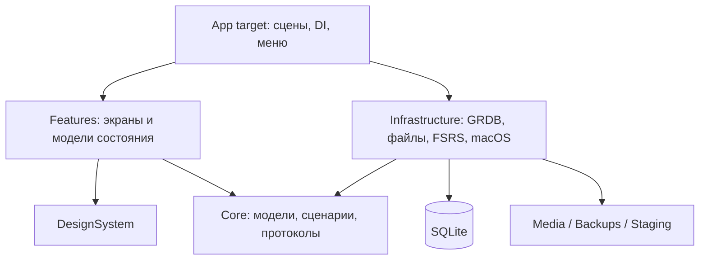

# Архитектура приложения

[Оглавление](README.md) · [Данные](DATA_MODEL.md) · [Повторение](REVIEW_ENGINE.md) · [Решения](DECISIONS.md)

## Стек и платформа

Обязательное ограничение: [ноль дополнительных платежей](BUDGET.md) сверх существующей подписки Codex. Стек выбирается из бесплатных системных инструментов и подходящих open-source библиотек. Основная работа локальна; стандартный public CI проверяет изменения. Платные API и платные runners не используются.

| Область | Предложение | Причина |
|---|---|---|
| Платформа | macOS 15+, arm64; MacBook с Apple Silicon | Нативный настольный продукт; минимальная версия — решение проекта, не ограничение аппаратной архитектуры |
| Язык | Swift 6 language mode; компилятор Swift 6.1+ в выбранном стабильном Xcode | Проверка изоляции конкурентного доступа и единый язык приложения |
| UI | SwiftUI, Observation; AppKit через узкие адаптеры | SwiftUI для экранов, AppKit для окон, меню, таблиц/текста при необходимости |
| Хранение | SQLite через GRDB, миграции SQL, FTS5 | Явные транзакции, сложные фильтры, история и контролируемое резервирование |
| Повторение | FSRS-6 через изолированный адаптер `swift-fsrs` | Чистый расчёт расписания независимо от UI и SQL |
| Графики | Swift Charts; календарная сетка SwiftUI/Canvas | Стандартные графики и отдельная реализация календаря активности |
| Медиа | AVFoundation/AVFAudio, ImageIO, UniformTypeIdentifiers | Локальное воспроизведение, синтез речи, изображения; позднее запись |
| Напоминания | UserNotifications | Локальные системные уведомления по разрешению пользователя |
| Архивы | ZIPFoundation за интерфейсом ArchiveService | Собственные копии и один из слоёв APKG; совместимость APKG этим не исчерпывается |
| Тесты | Swift Testing для логики; XCTest/XCUITest для приложения | Независимая проверка расчётов, базы и пользовательских сценариев |
| Сборка | Xcode app target + один локальный Swift Package с несколькими targets; SPM | Простая отладка и проверяемые границы модулей |
| Установка | Локальная Release `.app` на ноутбуке владельца | Публичный выпуск, Developer ID, notarization и DMG не обязательны; локальную подпись/entitlements проверить на целевом Mac |

Внешние зависимости закреплены и проверяются smoke-тестами T003: GRDB 7.11.1, swift-fsrs на точной revision с явной конфигурацией FSRS-6, ZIPFoundation 0.9.20. Pins, независимый reference fixture, лицензии, manifests и границы проверки описаны в [DEPENDENCIES.md](DEPENDENCIES.md). Выбор произвольных FSRS defaults запрещён. Первичные документы перечислены в [SOURCES.md](SOURCES.md).

## Общая структура

Это одно локальное приложение с внутренними модулями. Сервер и сетевой API для основной работы не нужны. Сначала одна активная коллекция и один процесс-владелец её записи. Дополнительные окна работают через тот же контекст коллекции.



Стрелка означает зависимость исходного кода. Сценарии Core вызывают инфраструктуру только через протоколы, реализацию которых передаёт App. Features не импортирует GRDB или FSRS и не выполняет SQL. DesignSystem не знает о колодах, расписании или коллекции.

| Модуль | Ответственность | Не должен делать |
|---|---|---|
| `AnkiNewApp` | Composition root, жизненный цикл, WindowGroup/Settings, маршруты, команды | Считать интервалы, изменять SQL-таблицы из View |
| `CardsCore` | Сущности, команды, query DTO, сценарии, scheduler/clock/store ports | Импортировать SwiftUI, GRDB, AVFoundation |
| `CardsInfrastructure` | Репозитории, миграции, файловые операции, адаптер FSRS, платформенные сервисы | Создавать экранные View или хранить глобальное состояние навигации |
| `CardsDesignSystem` | Токены, кнопки, поля, панели, сообщения, состояние загрузки | Получать коллекцию через глобальный singleton |
| `CardsFeatures` | Today/Decks/Study/Library/Editor/Statistics/Settings; UI-состояния | Связывать экран напрямую с внешней библиотекой хранения |
| Test targets | Доменные, интеграционные и UI-проверки | Требовать реальную коллекцию пользователя |

Внутри Core и Infrastructure достаточно папок по областям. Не создавать отдельный пакет и универсальный generic repository для каждой таблицы. Дополнительный модуль вводится, когда есть реальная независимая граница, а не ради количества слоёв.

## Основные сценарии и сервисы

Доменные IDs, DTO, единицы времени и календарные правила T005 описаны в [DOMAIN_TYPES.md](DOMAIN_TYPES.md).

Имена — предлагаемые контракты, а не уже написанные классы. UI получает только нужные ему сценарии из composition root.

| Контракт | Вход → результат | Важная гарантия |
|---|---|---|
| `DeckService` | Create/Update/Move/Delete с revisions → Deck DTO / affected count | Иерархия без циклов, атомарный набор изменений |
| `NoteService` | EditorDraft + baseRevision + commandID → Note/Card IDs и новая revision | Общие поля, варианты, теги и media refs сохраняются вместе |
| `LibraryQueryService` | Filter AST + sort + page cursor → page/count/selection metadata | Только разрешённые фильтры; стабильная пагинация |
| `StudySessionService` | SessionConfiguration → sessionID + текущая render model | Один активный scheduled session на коллекцию |
| `ReviewUseCase` | Rate/Undo/Skip с session/card revision → committed transition | Оценки и queue updates не расходятся при сбое |
| `Scheduler` | Schedule snapshot + parameter set + время/seed → four options / result | Чистый детерминированный расчёт, без сохранения |
| `StatsQueryService` | Period + deck scope + metric → series/summary | Единые effective events и учебные дни на всех экранах |
| `ImportService` | File + mapping + duplicate decisions → ImportPlan → commit report | Preview до записи; отмена до commit без частичной коллекции |
| `ExportService` | Scope + format capabilities + destination → verified file | Final file публикуется после проверки |
| `BackupService` | Collection snapshot request / выбранная копия → verified archive / restored context | Backup media соответствует snapshot; restore имеет rollback |
| `MediaService` | Selected file / playback / recording request → asset/ref/state | Staging и разрешения отделены от editor Save |
| `PreferencesService` | Typed setting change → validated persisted preference | Некорректное промежуточное значение не становится настройкой |
| `CollectionCoordinator` | Open/Close/Switch → новый CollectionContext | Lock, generation token и отмена старых задач |

Результаты команд включают business error и recoverable action, а не готовый локализованный текст сторонней библиотеки. Команды записей используют единый writer; query services могут оптимизировать SQL независимо от экранов. Типовые внешние вызовы получают cancellation и progress, а финальная короткая commit-фаза завершается определённым outcome даже при закрытии её progress UI.

## Предлагаемая структура исходников

```text
AnkiNew.xcodeproj/             # создаётся в T002
App/
  AnkiNewApp.swift
  CompositionRoot.swift
  CollectionCoordinator.swift
  Navigation/ Commands/ Resources/
Packages/CardsKit/
  Package.swift
  Sources/
    CardsCore/
      Models/ Ports/ UseCases/ Study/ Queries/
    CardsInfrastructure/
      Persistence/ Migrations/ Repositories/
      Scheduling/ Media/ ImportExport/ Backup/ Platform/
    CardsDesignSystem/
      Tokens/ Components/ Accessibility/
    CardsFeatures/
      Today/ Decks/ Study/ Library/ Editor/ Statistics/ Settings/
      Onboarding/ Collections/ Types/ Help/
  Tests/
    CardsCoreTests/ CardsInfrastructureTests/
    CardsFeaturesTests/ Fixtures/
UITests/
docs/                          # этот технический проект
design-references/             # неизменяемый визуальный источник
```

T002 создала Xcode-проект, четыре target локального пакета, composition root, навигацию, Settings scene и тестовые targets; фактический состав и запуск описаны в [каркасе приложения](APP_SCAFFOLD.md). Папки будущих предметных областей выше остаются предложением до реализации соответствующих задач. В ресурсах приложения хранить Asset Catalog, String Catalog и небольшие демо-данные. Все 48 тяжёлых PNG дизайн-архива в app bundle не включать.

## Поток изменения данных

```mermaid
sequenceDiagram
  participant V as StudyView
  participant S as StudyModel @MainActor
  participant U as ReviewUseCase
  participant W as CollectionWriter
  participant D as SQLite
  V->>S: rate(grade)
  S->>S: guard answerRevealed; state=committing
  S->>U: command(id, cardID, revision, grade, time)
  U->>W: execute атомарно
  W->>D: проверить revision; записать schedule + review + queue
  D-->>W: commit
  W-->>S: committed result
  S->>S: следующий вопрос, answerHidden
  D-->>S: наблюдаемые query snapshots
```

UI не показывает сохранённую оценку до успешного commit. При ошибке остаётся раскрытая карточка с возможностью повторить команду с тем же `commandID`; повтор не создаёт дубль. Сегодня, библиотека и статистика получают согласованные snapshots после изменения данных.

### Контракт команд и репозиториев T008

`CollectionStore` выдаёт по актуальному generation отдельные Core-порты `DeckRepository` и `CollectionInfoRepository`. Оба используют один `CollectionWriter` actor и тот же pool открытой коллекции. Порты принимают immutable Sendable команды и возвращают DTO; SQL и transaction closure доступны только внутри Infrastructure. Первые операции — чтение/сохранение простой колоды и чтение/переименование коллекции. Полные editor/Note, media и study-сценарии добавляют свои предметные порты в соответствующих задачах, используя тот же writer.

Writer выполняет синхронный GRDB `write` на своём actor: проверка journal, проверка revision, предметное изменение и запись результата происходят без `await` в одной короткой транзакции. Подготовка контента, файловые действия и UI выполняются до вызова. Для создания колоды expectedRevision=nil означает отсутствие ID, для изменения обязательна сохранённая revision; успешное изменение повышает её на один. Read выполняется через async GRDB и повторно проверяет lifecycle после ожидания. Close инвалидирует writer до закрытия pool, затем явно освобождает lease до возврата вызывающему коду (без зависимости от времени ARC deinit async-frame); уже начатый commit заканчивается определённым результатом, а следующий вызов старого репозитория возвращает staleContext, включая после reopen. Отмена до транзакции возвращает cancelled; после начала commit отмена не превращает сохранённый результат в ошибку.

`processed_commands` хранит envelope v1: kind, канонически сериализованная исходная команда и результирующий DTO. Повтор commandID с идентичным содержимым возвращает **исходный** результат до проверки текущей revision, в том числе после перезапуска и последующих изменений объекта. Повтор ID с другим содержимым/типом команды отклоняется как commandIDReused. Неуспешная команда не оставляет ни изменения, ни journal row и может быть повторена после устранения ошибки. Неизвестная версия результата отклоняется без повторного применения. Командные данные находятся только в локальной БД и не логируются. Удаление journal без отдельной политики безопасного срока повторов не допускается.

Ошибки портов — `CollectionRepositoryError`: notFound/alreadyExists, revisionConflict с ожидаемой и фактической revision, validation, invalidHierarchy, commandIDReused, staleContext, cancelled, unsupportedCommandResult, integrityFailure, insufficientSpace, permissionDenied и storage с техническим SQLite-кодом. DTO не содержит GRDB ошибок или пользовательских путей. Переименование коллекции меняет имя в SQLite и settingsRevision; manifest остаётся идентификационным bootstrap-документом, отображаемое актуальное имя берётся из SQLite.

## Состояние UI

У каждого feature — `@MainActor @Observable` модель состояния. View отображает свойства и передаёт намерения пользователя. Сетевые/дисковые операции возвращают типизированный результат; модель показывает loading, empty, content или error. Для занятия применяется отдельный автомат состояний из [REVIEW_ENGINE.md](REVIEW_ENGINE.md).

Редактор использует `EditorDraft` из значений, не живой database object. Открытие сохраняет `baseRevision`. Save проверяет поля и revision, затем атомарно меняет Note, генерируемые Cards, теги и ссылки медиа. Конфликт двух окон не перезаписывает чужую версию молча: показать обновлённую запись и предложить сохранить свой текст отдельно/повторно применить правки. Автосохранение общего документа редактора не вводится под видом настроек.

В настройках три области: AppPreferences в UserDefaults; CollectionSettings и учебные пресеты в SQLite; draft модального диалога в памяти. Автосохранение включает небольшой debounce для текстового/числового ввода, но не фиксирует некорректное промежуточное значение. Ошибка записи видна и возвращает сохранённое значение.

## Конкурентность и жизненный цикл

- MainActor обслуживает модели экранов и платформенные API, которые требуют главного потока. Декодирование больших изображений, парсинг, архивирование и SQL не выполняются синхронно из View.
- `CollectionWriter` — actor с доступом к одному GRDB DatabasePool. Все изменения коллекции проходят через него. Внутри короткого transaction closure нет `await`, файловых диалогов и тяжёлого расчёта. При ожиданиях actor может быть reentrant: после каждого `await` проверять поколение коллекции и revision, не считать изоляцию actor заменой транзакции.
- Чтение — async GRDB API и наблюдение запросов. Наружу выходят Sendable DTO, а не `Database`, connection или изменяемый объект стороннего scheduler. Отменять наблюдение при закрытии окна.
- `OperationCoordinator` допускает одну изменяющую длительную операцию для коллекции: import, restore, migration, media GC. Во время финального переключения данных блокируются новые записи и останавливаются связанные наблюдения.
- `CollectionCoordinator` выдаёт generation token. При смене коллекции старые async-результаты игнорируются, задачи отменяются, аудио останавливается. Одновременное повторение одной коллекции в двух окнах не разрешается; второе окно показывает существующее занятие.
- Сон/пробуждение пересчитывает очередь по Clock. Закрытие окна завершает/приостанавливает сессию; завершение процесса не должно требовать обработки следующей карточки для сохранения уже поставленной оценки.

Конкурентная модель опирается на [Swift concurrency](https://docs.swift.org/latest/documentation/the-swift-programming-language/concurrency/); MainActor не означает, что любой `async` автоматически уходит в фон.

## Навигация, команды и окна

`NavigationSplitView` содержит пять основных разделов. `AppRoute` хранит selection, выбранную колоду/карточку и детали, но не переносит большие модели в URL/route. `ModalRoute` — enum с идентификаторами объектов. Через одну маршрутизацию открываются команды меню, кнопки и сочетания клавиш.

Главное окно — Today/Decks/Library/Stats; Settings открывается нативной сценой настроек с четырьмя вкладками. Редактор сначала sheet, позднее отдельное окно с тем же use case. Инспектор скрывается в компактном окне. `FocusedValues`/focused commands определяют текущий контекст меню; сочетания не перехватывают ввод текста. В модальном окне фокус ограничен его контролами и после закрытия возвращается источнику.

## Ошибки и диагностика

Доменные ошибки: validation, notFound, revisionConflict, lockedCollection, unsupportedFormat, permissionDenied, insufficientSpace, integrityFailure, cancelled. Репозитории переводят ошибки SQLite/файлов в эти категории и сохраняют технический код для диагностики. Пользователь получает действие: исправить поле, выбрать папку, повторить, открыть другую копию.

`OSLog` использует категории database/study/import/backup/media/ui. Слова, переводы, абсолютные пользовательские пути и записи микрофона не логируются открытым текстом. Метрики длительности локальные, без внешней телеметрии по умолчанию. Диагностический экспорт создаётся явно пользователем.

## Расширение проекта

Расширения листов 25–42 используют уже существующие Note/Card/ReviewLog/CollectionContext. Типы добавляют схемы полей и шаблонов; временная колода — сохранённый запрос, а не перенос карточек; несколько коллекций — переключение контекста, а не один общий файл с неявным фильтром. Для внешней синхронизации или AI позднее потребуются отдельные ADR и задачи; сейчас их инфраструктура не добавляется.
