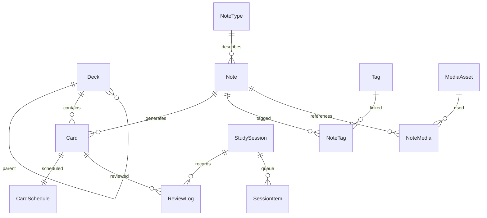

# Модель данных и сохранность

[Оглавление](README.md) · [Архитектура](ARCHITECTURE.md) · [Повторение](REVIEW_ENGINE.md)

## Размещение на диске

Путь Application Support получать через системный API внутри контейнера sandbox, не собирать вручную по имени пользователя.

```text
Application Support/<bundle>/
  registry.json                  # коллекции, последний выбор, bookmarks
  Collections/<collection-uuid>/
    collection.json              # UUID, имя, версия контейнера
    collection.sqlite            # рабочая схема
    collection.sqlite-wal        # управляется SQLite
    collection.sqlite-shm        # управляется SQLite
    Media/<sha256>.<ext>          # неизменяемые файлы
    Staging/<operation-uuid>/     # незавершённые операции
    Trash/<operation-uuid>/       # временный карантин файлов
    collection.lock              # advisory lock процесса, не просто флаг
  Backups/<collection-uuid>/      # по умолчанию вне восстанавливаемой папки
Caches/<bundle>/                  # превью, пересоздаваемые данные
```

Собственный экспортный архив имеет отдельный versioned формат и предлагаемое расширение `.cardsbackup`. Название расширения и UTI фиксируются в T002/T027. Родной переносимый экспорт колоды — `.cardsdeck`. При работе с выбранным пользователем внешним расположением сохраняется security-scoped bookmark; недействительный доступ требует повторного выбора. Резервная копия на том же физическом диске не защищает от его потери — пользователь может экспортировать её на другой носитель.

В одной БД — одна коллекция. Пользовательские тексты в UTF-8, UUID как TEXT, даты как UTC epoch milliseconds в INTEGER; длительности в milliseconds, интервалы scheduler в явно обозначенных units. JSON имеет `schemaVersion`. Числовые значения проверяются на finite и допустимый диапазон до SQL-записи. Файловый формат и версия схемы SQLite — разные версии.

Независимые от SQL типы и явные преобразования единиц зафиксированы в [DOMAIN_TYPES.md](DOMAIN_TYPES.md); UTC timestamp и elapsed duration представлены разными Swift-типами.

## Владение и открытие (T007)

`CollectionStore` открывает одну активную коллекцию. Версионированный `registry.json`
содержит UUID единственной коллекции и последний выбор; путь выводится из UUID, а не
из произвольной строки JSON. Bookmarks и выбор внешних коллекций остаются последующими
задачами. Начальное имя — «Моя коллекция». При первом запуске создаются Media, Staging,
Trash, manifest и SQLite с одним UUID; registry атомарно публикуется последним.
Незавершённая первичная инициализация не становится выбранной коллекцией.

Перед чтением/созданием registry берётся короткая `.registry.lock`, перед любым
изменением контейнера — `flock(LOCK_EX | LOCK_NB)` на `collection.lock`. Дескриптор
имеет close-on-exec; lock опубликованного контейнера никогда не удаляется/не заменяется, чтобы все владельцы
блокировали один inode. Наличие файла и PID не определяют занятость: после crash
ядро освобождает блокировку, оставшийся файл безопасно используется снова. Это
кооперативное владение локальным контейнером, не защита от внешнего SQL-редактора.

При существующем контейнере manifest version/UUID, наличие БД и её UUID проверяются
до writable connection/миграции; mismatch не исправляется молча. Ошибки не меняют
registry и не удерживают lease. При close сначала закрывается pool, затем lease;
если close pool не удался, владение сохраняется для повторного close.

Core передаёт `CollectionContext` с уникальным UUID поколения. Store проверяет его
перед доступом и игнорирует close старого поколения. App `CollectionCoordinator`
инвалидирует UI-поколение до await, останавливает зарегистрированные наблюдения и
задачи, принимает результаты только текущего контекста. Закрытый open-result также
освобождает свой lease. Дополнительные окна используют один coordinator приложения.
Ошибку занятости показываем с предложением вернуться к открытому экземпляру или
повторить после его закрытия; выбор другой коллекции пока не подключён.

## Связи



## Таблицы первоначальной схемы

| Сущность | Основные поля | Правила |
|---|---|---|
| `collection_meta` | id, name, containerVersion, schemaVersion, createdAt, settingsRevision | Ровно одна строка; UUID сверяется с manifest контейнера |
| `decks` | id, parentID?, name, normalizedName, description, iconKey, colorKey, favorite, sortOrder, presetID?, revision, deletedAt? | Имя уникально среди активных соседей; parent не может быть собой/потомком |
| `note_types` | id, stableKey, name, version, fieldsSchemaJSON, templatesJSON, revision, deletedAt? | В M1 встроенный Basic; с начала хранить версию и stable IDs полей/шаблонов |
| `notes` | id, noteTypeID, fieldsJSON, contentVersion, normalizedFront, createdAt, updatedAt, revision, deletedAt? | Источник общего содержимого; нет собственного расписания; rich text — безопасная структурированная модель |
| `cards` | id, noteID, deckID, variantKey, templateID, clozeIndex?, generationState, suspended, buriedUntil?, flag, createdAt, revision, deletedAt? | Уникальность noteID+variantKey; `generationState` различает active/suppressed/orphaned |
| `card_schedules` | cardID, algorithmID, algorithmVersion, parameterSetID, phase, stability?, difficulty?, dueAt?, lastReviewAt?, repetitions, lapses, learningStep?, scheduleEpoch, revision | Для новой карточки память ещё не оценена; state не подменяется отрицательным интервалом |
| `scheduler_parameters` | id, algorithmVersion, weightsJSON, desiredRetention, maximumIntervalDays, learningPolicyJSON, createdAt | Неизменяемый набор; изменение создаёт новый ID, история хранит старый |
| `deck_presets` | id, name, newLimit, reviewLimit, schedulerParameterSetID, orderPolicyJSON, revision | default коллекции плюс явное назначение колоде; не сохранять копии в каждом UI |
| `tags` / `note_tags` | tag id/name/normalizedName/color/revision/deletedAt?; noteID+tagID | Теги относятся к Note: все варианты записи показывают те же теги; уникальны активные normalizedName |
| `media_assets` | id, sha256, relativePath, uti, byteCount, createdAt, lifecycleState | Хеш уникален, пути только внутри Media; оригинальное имя — отображаемая metadata, не путь |
| `note_media` | noteID, mediaID, fieldID, role, orderIndex | Ссылки из контента и таблицы согласуются в одной транзакции |
| `study_sessions` | id, mode, scopeJSON, startedAt, lastActivityAt, endedAt?, status, activeDurationMs, studyPolicyJSON, revision | scope и политика фиксируются для объяснимой сессии; завершение не удаляет оценки |
| `session_items` | id, sessionID, cardID, queueOrdinal, stage, eligibleAt?, presentedAt?, typedDraft?, generation | Очередь восстанавливается; reveal сам не считается оценкой; текст черновика при желании очищается при выходе |
| `review_logs` | id, commandID, cardID?, cardIdentitySnapshot, sessionID?, ratedAt, studyDayKey, timezoneID, deckIDSnapshot, grade, phaseBefore, durationMs, beforeJSON, afterJSON, parameterSetID, scheduleEpoch, voidedBy? | Одна эффективная запись на команду; снимки содержат расписание и revision, а не все медиа/переводы |
| `domain_events` | id, commandID, type, objectID, occurredAt, payloadVersion, payloadJSON | Reset, undo, move, suspend, delete; технический журнал, не полное event sourcing приложения |
| `processed_commands` | commandID, resultVersion, resultJSON, createdAt | Идемпотентность записи при повторе после сбоя связи UI с локальным сервисом |
| `collection_settings` | key, valueJSON, revision | Часовой пояс, начало учебного дня, учебные цели; ключи и миграции типизированы |
| `local_notifications` | id, kind, createdAt, payloadJSON, readAt? | Центр сообщений внутри приложения; не список реально доставленных системных баннеров |
| `operation_journal` | id, kind, phase, stagingRelativePath, manifestJSON, startedAt, completedAt? | Фиксирует recoverable-переходы между файловой системой и БД |
| `deletion_batches` | id, kind, affectedIDsJSON, deletedAt, undoUntil?, purgeAfter, state | Логическое удаление, отмена и отложенная очистка различаются |

Таблицы расширений: `saved_filters`, `temporary_decks` как query definitions; `import_sources`/`external_ids` для стабильных внешних IDs; `day_limit_overrides`; `template_revisions`; `app_migration_history`. Их добавлять миграциями, когда начинается соответствующая задача. `daily_statistics` — пересоздаваемый кэш, не единственный источник истории.

## Содержимое Note и генерация Card

`fieldsJSON` хранит поля по стабильным fieldID, а не русским названиям. Начальная схема: front, back, pronunciation, examples[] с парами en/ru, audio/image references. Поля и шаблоны не содержат исполняемый JavaScript. Для форматирования — AST блоков/inline marks (bold/italic/underline/lineBreak/media), сериализуемый с версией; импортированный HTML проходит конвертер или выдаёт отчёт о потерях.

Примеры variantKey: `basic.forward`, `reverse.forward`, `reverse.backward`, `cloze.<stable-placeholder-id>`, `typed.forward`, позднее `audio.forward`. Встроенные типы используют тот же механизм схем, что будущий визуальный менеджер. При Save сравнить старое и новое множество вариантов: существующие сохраняют ID и расписание; новые получают fresh schedule; исчезнувшие становятся orphaned после предпросмотра последствий. Нельзя сбрасывать прогресс всех карточек при редактировании перевода.

Удаление одной Card ставит `generationState=suppressed` и tombstone; вариант не появляется снова при обычном Save Note. Восстановить вариант можно явным действием. Удаление последнего активного варианта позволяет скрыть неиспользуемую Note, но не теряет информацию до окончания политики очистки. «Удалить запись и все варианты» — отдельная область подтверждения. Перенос Card меняет её deckID, не скрыто перемещает связанные варианты из других колод.

## Индексы и запросы

- Частичный UNIQUE `(coalesce(parentID, rootSentinel), normalizedName)` для активных колод; нормализация NFC, trim и locale-independent case folding. Названия для отображения сохраняются отдельно. Аналогичная уникальность тегов.
- Индексы `cards(deckID, deletedAt, suspended)`, `cards(noteID, variantKey)`, `card_schedules(dueAt, phase)`, `review_logs(studyDayKey, deckIDSnapshot, voidedBy)`, `session_items(sessionID, stage, queueOrdinal)`, `external_ids(sourceID, externalID)`.
- Включить foreign keys на каждом соединении. Не делать каскадное физическое удаление review history вместе с карточкой; nullable FK и identity snapshot позволяют хранить агрегаты после purge.
- FTS5 индексирует нормализованные front/back/examples по Note; запрос возвращает Card DTO с выбранным вариантом. Индекс обновляется в той же транзакции или в восстанавливаемой outbox-операции, без окна «сохранено, но потерялось навсегда в поиске».
- Строки поиска передаются параметрами. Пользовательский advanced query разбирается в AST с whitelist полей/операторов, не исполняется как SQL. Введённые символы синтаксиса FTS экранируются.
- Библиотека загружает страницы по 100 строк и стабильной сортировке с ID как tie-breaker; общий count — отдельный запрос. Не загружать весь набор в SwiftUI для последующего фильтра.

## Атомарные операции

| Команда | В одной транзакции |
|---|---|
| SaveNote | Проверка revision, поля, теги, ссылки медиа, генерация вариантов, FTS, event |
| RateCard | Проверка состояния/commandID/revision, расписание, ReviewLog, SessionItem, дневные счётчики/инвалидация кэшей |
| UndoRate | Проверка последней разрешённой команды, восстановление schedule snapshot, voidedBy, событие компенсации, очередь |
| MoveCards | Проверка назначения и набора выбранных revisions, deckID, revisions, событие |
| ResetProgress | Новая scheduleEpoch, fresh schedule, событие reset; старая история остаётся отмеченной прежней эпохой |
| DeleteCards | Tombstone/suppression, batch с undoUntil, исключение из очередей и списков |
| ApplyImport | Результат staging с UUID mapping, Notes/Cards/tags/media refs, external IDs, импортный журнал |

Файлы не являются частью SQL-транзакции. Для них используется протокол staging → проверка хеша → immutable publish → SQL commit → mark completed. При сбое до commit остаются только безопасные неиспользуемые файлы; после commit ссылки ведут на уже опубликованное содержимое. Startup recovery сверяет журнал; сборщик мусора не удаляет данные из активных операций и ещё доступных undo batches.

## Удаление и история

Удаление из UI скрывает данные сразу после commit. Отмена карточки доступна 5 секунд по monotonic clock; после этого кнопка исчезает, но физический purge может выполняться позже. Предлагаемый внутренний grace period — 7 дней, это не обещание пользовательской корзины и не альтернатива резервной копии. При окончательном удалении Note/media тексты уходят из базы/папки; агрегаты review могут оставаться с обезличенным snapshot. «Удалить все учебные данные» очищает и историю после отдельного подтверждения, а не вызывает обычный tombstone.

Статистика прошлых занятий группируется по deckIDSnapshot/имени на момент события; перенос карточки сегодня не переписывает прошлую активность. Для фильтра по текущему составу колоды можно добавить отдельный режим позднее, не смешивая обе семантики. Удалённая колода имеет понятную историческую подпись.

## Миграции и восстановление

T006 реализует первоначальную SQLite-схему v1 в `CardsInfrastructure/Migrations/InitialSchema.swift` и открытие через `Persistence/CollectionDatabase.swift`. Все 21 предметная таблица — STRICT; UUID сохраняются как TEXT, timestamps/durations/revisions — INTEGER, scheduler stability — дни в REAL, difficulty — REAL 1…10. JSON-колонки содержат валидный объект с положительным целым `schemaVersion` (массив весов/IDs находится внутри envelope). Допустимые numeric ranges и enum states дополнительно ограничены CHECK. Core IDs и нормализация NFC/case-folding применяются до SQL; SQLite не нормализует Unicode самостоятельно.

`collection_meta` создаётся в транзакции v1 с явно переданными ID, именем и временем; singleton-ограничение и triggers защищают строку от дублирования, удаления и смены UUID. Остальные таблицы изначально пусты: встроенные типы/пресеты и fixtures создаются последующими сценариями. `cards(noteID, variantKey)` остаётся UNIQUE и после tombstone; SQL triggers запрещают циклы колод. История ссылается на Card/Session через `ON DELETE SET NULL`, snapshots и parameter sets сохраняются. Schedule/queue/join rows удаляются каскадно при физическом purge; физическое удаление родителей с живыми зависимостями запрещено. Параметры scheduler не изменяются UPDATE: создаётся новый ID.

Первоначальные persisted состояния: `study_sessions.mode` = scheduled/practice, status = active/paused/completed/abandoned; не более одной active/paused scheduled-сессии. `session_items.stage` = queued/question/answer/rated/skipped, пауза принадлежит сессии; восстановление скрывает ответ на уровне будущего сервиса. Media lifecycle = published/orphaned/trashed; ссылка хранит плоский путь `Media/<filename>` без абсолютного пути, вложенных директорий, traversal и NUL. `deletion_batches.state` = pending/restored/purged. Остальные kind/phase/policy значения задаются профильными сервисами. FTS и таблицы расширений добавляются своими задачами (FTS — T010).

Открытие синхронное и должно выполняться вне main actor при эксклюзивном владении коллекцией; процессный lock/manifest и generation относятся к T007. GRDB DatabasePool использует WAL, foreign keys на всех соединениях и busy timeout 5 секунд. Public API возвращает только Sendable metadata; pool/SQL остаются внутри Infrastructure. Перед writable pool выполняется OPEN_READONLY preflight: сверяются `PRAGMA user_version`, `collection_meta.schemaVersion` и полный набор `grdb_migrations`. Неизвестная более новая версия/миграция и рассогласованные маркеры отклоняются; чужая непустая БД не принимается за новую. SQLite использует WAL/SHM coordination-файлы и при read-only чтении WAL-базы; содержимое БД и committed WAL frames не меняются.

Каждая миграция, её schema metadata, user_version и GRDB marker фиксируются одной транзакцией с проверкой integrity/foreign keys. Ошибка откатывает DDL, данные и маркеры; auto-erase и down migration отключены. Перед обновлением уже инициализированной БД создаётся отдельный `collection.sqlite.pre-migration-vN-<uuid>.sqlite` рядом с исходником через SQLite Backup API; проверяются integrity, foreign keys и версия копии. Неуспех копии, в том числе disk full, прерывает обновление до SQL-изменений. Копии сохраняются и при неуспешной миграции; это только schema snapshot, полноценный backup с media и UI реализуется T027/T028. В v1 нет production upgrade с предыдущих версий; upgrade/rollback/backup path проверяется инъекцией тестовой v2 на синтетической file-БД.

Миграции монотонные и версионированные, проверяются на копиях реальных fixtures. Перед изменением схемы создаётся проверенная резервная копия; недостаточно места — миграция не начинается. Новый файл с неизвестной более высокой версией не открывается на запись: показать необходимость более новой сборки. Откат — открытие старой копии совместимой версией, не попытка автоматически «обратить» произвольный SQL.

Восстановление сначала распаковывает и проверяет отдельный контейнер: manifest, hash каждого файла, SQLite integrity и foreign keys, schema/collection IDs. Затем закрываются observers/connections, текущая папка переименовывается в rollback, staging занимает её место, открывается новый контекст. Внешний swap journal и rollback лежат вне заменяемой папки. При падении между rename startup выбирает последнее проверенное состояние. Старые WAL/SHM не примешиваются к восстановленной БД.

Резервирование при работающей БД выполняется через согласованный snapshot [SQLite Backup API](https://www.sqlite.org/backup.html) / GRDB backup. Координатор запрещает изменения и media GC на время фиксации manifest ссылок; копируются именно файлы snapshot, затем блокировка снимается. В архиве нет временных lock, staging, cache и открытых WAL-файлов.
