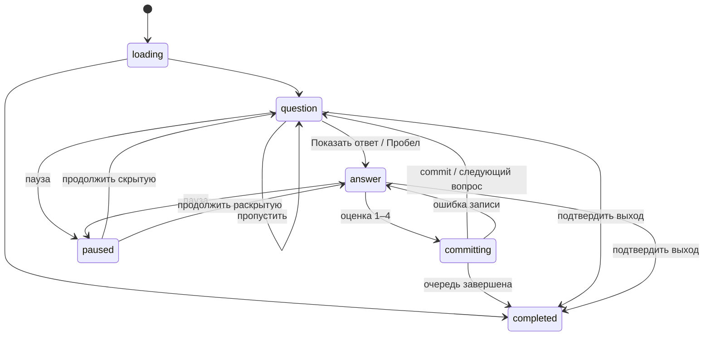

# Движок повторения

[Оглавление](README.md) · [Данные](DATA_MODEL.md) · [Поведение дизайна](../design-references/FLOWS.md)

## Границы

`Scheduler` рассчитывает возможные переходы CardSchedule. `QueueBuilder` определяет, какие карточки можно показать. `StudySessionService` управляет занятием. `ReviewUseCase` атомарно применяет оценку. UI не считает интервалы и не сохраняет их из текста на кнопке.

Контракты ниже концептуальные, их точные Swift-сигнатуры фиксируются при реализации:

```swift
protocol Scheduler: Sendable {
    func preview(_ input: SchedulingInput) throws -> RatingOptions
    func apply(_ input: SchedulingInput, grade: Grade) throws -> SchedulingResult
}
// SchedulingInput: schedule snapshot + nowUTC + parameter set + deterministic seed
// RatingOptions: четыре варианта с dueAt и пояснением
// SchedulingResult: новое расписание и расчётные metadata
```

`Grade` — again=1, hard=2, good=3, easy=4. Adapter явно переводит enum приложения в enum библиотеки. Состояния scheduler: new / learning / review / relearning. Suspended, deleted и buried — отдельные ограничения доступности, не дополнительные оценки.

Начальная цель удержания — предлагаемое 0,90, параметры FSRS — опубликованный набор для выбранной версии библиотеки. Это настройки алгоритма, не обещание 90% результата. Оптимизатор персональных весов и обучение ML-модели не входят в первоначальный план. Версия алгоритма, параметры и policy сохраняются рядом с историей.

## Автомат занятия



Реализованный экран T019, события и границы подключения: [Экран занятия](STUDY_SESSION.md).

Paused хранит предыдущее состояние, а не выбирает его произвольно. В committing повторная оценка недоступна; уже нажатая кнопка не создаёт вторую команду. При Skip очередная карточка скрыта, расписание пропущенной не меняется. Если во всей сессии больше нет доступных элементов, показать итог «просмотрены доступные», а не объявлять все пропущенные карточки выученными.

Карточка с вводом ответа хранит draft. Обычный Space внутри активного текстового поля вводит пробел, а не перехватывается. Раскрытие доступно кнопкой и явной командой вне поля; для многословного ответа это принципиально. После раскрытия показать сравнение и те же четыре оценки. Нормализация сравнения: Unicode NFC, trim, настройка регистра; пунктуацию/апострофы не выбрасывать молча. Посимвольная подсветка учитывает grapheme clusters. Система не выбирает оценку за пользователя.

## Построение очереди

1. Зафиксировать collection generation, scope выбранных колод с потомками, режим и лимиты.
2. Исключить tombstones, suppressed/orphaned variants, suspended, buriedUntil > now и карточки с невалидным шаблоном. Доступность пересверять перед показом и commit, поскольку библиотека может измениться в другом окне.
3. Выбрать learning/relearning с `dueAt <= now` по сроку; затем overdue/review; затем new по стабильному порядку. Это начальная политика, позже сохраняемая в пресете.
4. Отобрать review/new в пределах оставшихся дневных квот и параметров текущей сессии. Потомки считаются один раз по уникальному CardID, а не суммированием уже агрегированных родительских счётчиков.
5. Прямые/обратные siblings одной Note не показывать подряд; на первое время sibling bury действует до следующего учебного дня после первой оценки. Пользовательская отмена восстанавливает соответствующее ограничение.
6. После каждого commit пересчитать ближайшие ready learning items; будущую карточку не показывать раньше dueAt ради заполнения экрана. Если остались только будущие элементы, показать «На сейчас всё» и ближайшее время, дать закончить или дождаться.

Preview рассчитывается без мутации и не создаёт ReviewLog. При оценке расчёт производится по зафиксированному event time и seed команды, а не по строке интервала из preview. Если время существенно изменилось, обновить варианты до принятия ввода. Fuzz либо отключён для начальной детерминированной версии, либо имеет сохраняемый seed; не должен менять результат при повторе команды.

Реализованный чистый контракт T018, причины пустоты и правила резервирования квот:
[Учебная очередь](STUDY_QUEUE.md).

## Учебный день и квоты

Начало учебного дня по умолчанию — 04:00 в часовом поясе коллекции, первоначально выбранном из системного. `StudyDayKey` — локальная дата, полученная через Calendar с учётом rollover; сутки не равны всегда 86400 секундам. Хранить timezoneID и day key события, чтобы путешествие не переписывало прошлую историю. Изменение timezone/rollover действует на будущие события, пересчёт прошлого — отдельная явная операция, не побочный эффект настроек.

Предлагаемые начальные лимиты: 20 новых Card в день, 200 уникальных review Card в день на коллекцию. Значения редактируемые. Колода может иметь более строгий лимит; эффективный остаток — минимум квот коллекции и применённых предков. Learning/relearning не расходуют второй раз new/review quota и не блокируются обычным review limit: пользователь должен иметь возможность закончить начатое обучение.

Новая карточка расходует new quota при первой эффективной оценке этого дня. Review quota — уникальные Card, вошедшие в review из очереди в этот день; повторный Again не считается второй уникальной review-карточкой, но учитывается отдельной оценкой в статистике. Undo пересчитывает эффективное потребление. Reset и смена колоды не позволяют бесконечно обходить квоту тем же CardID. Изменение лимита на сегодня — отдельный day override, не постоянная смена пресета.

Session limit — дополнительная граница выбранных уникальных карточек, не жёсткий запрет завершить ближайшие learning steps. Дизайн счётчика должен пояснять, показывает он обработанные уникальные карточки или количество оценок. Бесплатный режим «без изменения расписания» в расширенном занятии маркируется отдельно и исключается из обычных scheduling events.

## FSRS и короткие шаги

FSRS-адаптер отвечает за память и долгосрочные due dates. Политика коротких learning/relearning steps принадлежит одному уровню и фиксируется в T017: использовать поддержанный библиотекой режим либо проверенную обёртку, не применять одновременно две несовместимые схемы. Начальный предложенный профиль короткого возврата — 1 и 10 минут, но итоговые переходы по всем четырём оценкам должны быть описаны и проверены контрольными векторами до UI-интеграции. Ни «1 минута», ни «4 дня» из PNG не являются обязательной формулой.

Изменение desiredRetention/весов не переписывает все старые due dates автоматически. Новые оценки используют новую parameterSet; массовое перепланирование — отдельная подтверждаемая команда с копией. Отсутствующие/NaN-значения scheduler блокируют конкретную запись с диагностикой, а не записывают повреждённый интервал.

### Контракт адаптера T017

`FSRS6Scheduler` реализует чистый `CardsCore.Scheduler`. Единственный владелец
коротких шагов — `BasicSchedulerV6` закреплённой библиотеки; адаптер не добавляет
второй learning policy поверх результата. Policy schemaVersion=1 включает
short term=true, fuzz=false, learning=[1m,10m], relearning=[10m].
Индекс шага нулевой. Точная таблица для начального профиля:

| Вход | Again | Hard | Good | Easy |
|---|---|---|---|---|
| new / learning, step 0 | learning, 0, +1m | learning, 0, +6m | learning, 1, +10m | review, FSRS |
| learning, step 1 | learning, 0, +1m | learning, 1, +6m | review, FSRS | review, FSRS |
| review | relearning, 0, +10m; lapses+1 | review, FSRS | review, FSRS | review, FSRS |
| relearning, step 0 | relearning, 0, +10m | relearning, 0, +15m | review, FSRS | review, FSRS |

Каждая оценка обновляет memory state ровно один раз и увеличивает repetitions.
Lapses увеличивается только при review→Again. Hard в learning всегда использует
округлённое среднее первых двух шагов (6m), включая step 1; в одношаговом
relearning — 1.5 первого шага (15m). Это проверенное поведение pinned версии,
а не интервалы из PNG. Easy всегда выпускает в review. Допускаются пустые
списки (сразу FSRS) и до 64 строго возрастающих целых минутных шагов <1 суток;
Hard следует той же формуле библиотеки. Смена профиля с несовместимым текущим
индексом отклоняется, а не молча пропускает шаг.

Вход содержит immutable `CardScheduleSnapshot` schemaVersion=1 (CardID,
algorithmID/version, parameterSetID, phase, память, due/lastReview, счётчики,
шаг, epoch/revision), явные nowUTC, seed и полный выбранный parameter set.
Выход содержит before/after и metadata schemaVersion=1 с полным parameter set,
revision адаптера/upstream, now, seed, grade, elapsed/scheduled days. Snapshot
полон для расчёта/будущего Undo; SQL и journal относятся к следующим задачам.
Расчёт повышает revision на один, сохраняет CardID/epoch и фиксирует новый
parameterSetID только в after; preview ничего не сохраняет.

Fuzz выключен: seed сохраняется в metadata, но не влияет на интервалы.
Время поступает только от вызывающего кода; скрытого Date()/Clock нет.
FSRS elapsed days — число пересечённых UTC-полуночей pinned реализации,
а долгий interval day = 86400 секунд. Это не StudyDayKey, квоты или DST-день.
now до lastReview (включая откат внутри дня) запрещён; early review разрешён.
Поддерживаемые даты — 0001…9999 UTC с проверкой результата. Новая память nil;
у остальных фаз обязательны finite stability ≥0.001, difficulty 1…10,
due/lastReview и согласованные счётчики/шаг. Неизвестные версии, NaN/Infinity,
неполные snapshots, переполнение revision/counters, неверные параметры и веса,
которые upstream стал бы молча clamp, дают типизированную ошибку до сохранения.
Retention разрешён 0.01…0.99, maximumIntervalDays 1…36500. При насыщении
review интервалы upstream могут раздвигаться на +1/+2 дня ради порядка оценок;
адаптер ограничивает каждый долгий результат maximumIntervalDays (на границе
возможны равные интервалы), сохраняя рассчитанную память. Короткие шаги не меняются.

## Сохранение, восстановление и Undo

Реализованный контракт T020: [Атомарная оценка и Undo](REVIEW_TRANSACTIONS.md).

Оценка включает commandID, cardID, sessionID, expected schedule revision, event time, duration и grade. Транзакция проверяет ревизию, пишет before/after schedule, review log, продвижение очереди и processed command. Если процесс закрылся после commit, повтор команды возвращает сохранённый результат. Если commit не произошёл, карточка остаётся неоценённой.

Undo последней оценки разрешён только при совпадении текущей schedule revision с after snapshot и отсутствии последующей несовместимой команды. Он создаёт событие компенсации, помечает исходный log как voided и восстанавливает before snapshot с новой revision. Все статистические запросы исключают voided reviews. История может показать отменённое действие отдельно. После восстановления приложение возвращает предыдущую карточку в раскрытое состояние для новой оценки.

Пропуск не пишет оценку; откладывание до завтра в расширениях задаёт buriedUntil на границу следующего учебного дня; приостановка бессрочная до явного возобновления. ResetProgress начинает новую scheduleEpoch и новую карточку расписания, сохраняя старую историческую активность. Нельзя представлять сброс как удаление всех когда-либо выполненных занятий.

Сессия сохраняет очередь после каждого завершённого действия; пауза и уход в фон сохраняют checkpoint. При восстановлении ответ консервативно скрывается, сохранённые оценки не повторяются. Занятие не блокирует UI сном до dueAt: Clock проверяется при активации/таймере.

## Определения статистики

| Показатель | Формула / источник |
|---|---|
| Повторения | Количество эффективных ReviewLog с grade, включая повторный показ той же Card |
| Карточек пройдено | DISTINCT card identity среди эффективных оценок |
| Успешные ответы | (Hard + Good + Easy) / все оценки; при нуле — «нет данных», не 100% |
| Модельная вероятность | Расчёт scheduler на заданное время; отдельная подпись, не доля ответов |
| Время | Активные интервалы в foreground; пауза, сон, длинный idle не входят; предельное response time 60 секунд как начальное правило |
| Серия | Последовательные StudyDayKey с хотя бы одной эффективной оценкой |
| Прогноз | Распределение текущих dueAt по дням без моделирования ещё не выбранных оценок; подписать ограничение |
| Историческая колода | deck snapshot события, а не текущая принадлежность карточки |

Границы периода полуоткрытые `[start, end)`. Все экраны используют один StatsQueryService, одинаковые timezone/day semantics и общую фильтрацию voided events. Демонстрационные графики не подставляются при отсутствии данных.
