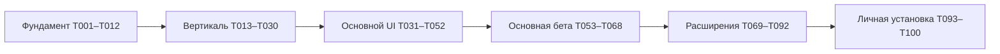

# Порядок разработки

[Оглавление](README.md) · [Реестр задач](TASKS.md)

Разрабатывать последовательными рабочими результатами. Не начинать с одновременной отрисовки всех 168 панелей: сначала проверить сквозную запись и повторение на настоящей локальной БД, затем достроить остальные состояния поверх тех же сервисов. Все расширения сохранены в плане.

## Как брать задачу

1. Открыть карточку задачи и убедиться в готовности всех её dependencies. Проверить актуальность архитектурного контракта.
2. Зафиксировать ожидаемый пользовательский результат и используемые fixtures; для изменения схемы — миграцию и путь восстановления.
3. Сделать минимальное законченное изменение в указанном модуле. Сложную L-задачу допустимо разбить на внутренние шаги/несколько изменений, но не убирать её acceptance criteria.
4. Выполнить указанную проверку и относящиеся к изменению тесты. UI проверить с реальным use case, не только preview.
5. Сохранить evidence: commands/result, fixture, screenshot при необходимости и известные ограничения. Заполнить отчёт и выполнить scripts/tasks.py finish, затем проверить и закоммитить автоматически синхронизированные статусы.

Пока реализация не начата, никакие кодовые/пользовательские проверки из этого плана не считаются пройденными. Проверены только полнота и внутренняя связность самой документации.

## M0 · Фундамент

**Задачи:** [T001](tasks/T001.md)–[T012](tasks/T012.md). **Выход:** Воспроизводимая сборка, схема, изолированные сервисы и fixtures.

Самые ранние риски: toolchain/dependencies, схема, файловый lifecycle и scheduler configuration. На этом этапе не нужна идеальная визуальная отделка экранов.

## M1 · Первая рабочая вертикаль

**Задачи:** [T013](tasks/T013.md)–[T030](tasks/T030.md). **Выход:** Создание → повторение → статистика → перезапуск → backup/restore.

Контрольная точка T030: пользовательский цикл от создания до перезапуска и восстановления. До неё не расширять архитектуру облаком/сервисами. Вертикаль уже должна использовать реальные транзакции, а не in-memory demo store.

## M2 · Полный основной интерфейс

**Задачи:** [T031](tasks/T031.md)–[T052](tasks/T052.md). **Выход:** Сценарии и компоненты листов 01–24; APKG ещё проходит отдельную приёмку.

Контрольная точка T052: основной UI покрыт, но APKG compatibility и hardening ещё принимаются отдельно. Непринятую возможность показывать недоступной с причиной, не работающей заглушкой.

## M3 · Основная бета и перенос данных

**Задачи:** [T053](tasks/T053.md)–[T068](tasks/T068.md). **Выход:** Сохранность, миграции, совместимость APKG, доступность и core acceptance.

Контрольная точка T068: первая полноценная основная бета по листам 01–24. T055–T064 — отдельная цепочка APKG. Опасные файловые сценарии и upgrade проверяются до работы с важной коллекцией.

## M4 · Расширенный дизайн-проект

**Задачи:** [T069](tasks/T069.md)–[T092](tasks/T092.md). **Выход:** Предложения листов 25–42, интеграция и трассировка всех состояний.

Контрольная точка T092: весь расширенный проект 25–42. Техническая последовательность учитывает типы/шаблоны до массового использования этих схем, коллекции до многооконного переключения, доступность до финальной анимации.

## M5 · Личная установка и завершение

**Задачи:** [T093](tasks/T093.md)–[T100](tasks/T100.md). **Выход:** Проверка на ноутбуке владельца, локальная .app, обновление и восстановление.

Контрольная точка T100: воспроизводимая локальная .app и инструкция восстановления. Платная подпись, notarization и публичная публикация не являются условиями готовности личного приложения.

## Основные цепочки зависимостей

- Данные: T006 → T007/T008 → T009/T011 → T053/T054 → T061/T062 → T097.
- Повторение: T005/T014 → T017 → T018 → T019 → T020/T022 → T028 → T066.
- APKG: T055 → T056 → T057/T058 → T059 → T060/T064 → T068.
- Сложные типы: T037 → T076 → T077 → T078 → T079/T081.
- Несколько коллекций/окон: T007/T048 → T083 → T084/T087 → T091.

Это обзор, полный список предшественников находится в каждой карточке и backlog.json. Зависимости образуют DAG; отложенные задачи нельзя считать завершёнными из-за готовности изображения.

## Оценка объёма и изменения плана

Здесь нет календарного обещания: задачи отличаются по риску, а окружение целевого ноутбука и APKG fixtures ещё предстоит проверить. После M0 и M1 можно оценить фактическую скорость и построить календарь. Вычеркивание функции допускается только как явное изменение объёма с обновлением трассировки; автоматический переход к «готово» при нехватке времени недопустим.

При разработке расширений уже принятая основная бета остаётся запускаемой. Новые schema versions мигрируют существующие коллекции, а не требуют начать всё заново. Реализация full project не должна зависеть от временных demo-only решений первой вертикали.
